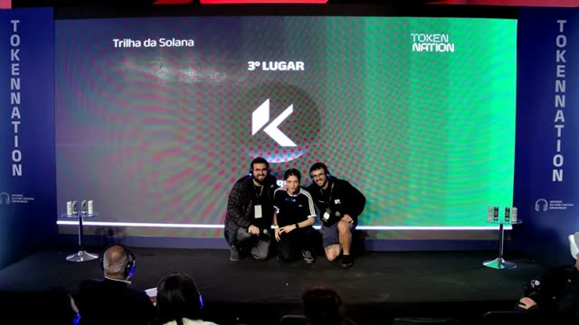

##  >_ Ah, Hello!

I've been waiting for you... *(glad you finally made it.)*

I'm **Kauã Miguel**, a 20-year-old Brazilian Full Stack Developer with a soft spot for the frontend. I've been writing code since I was 14, back when I (sort of) gave up on design because my machine couldn't run design software, but could happily run HTML and JavaScript.

These days I build things for the web, with a growing interest in software architecture and cloud.

## >_ About Me

* **Technical Degree in Systems Development** — ETEC Albert Einstein
* **B.Sc. in Systems Analysis & Development** — UNIP
* **Postgraduate Studies in Software Architecture** — FIAP *(in progress)*
* **2x AWS Certified** · **1x Azure Certified**
* **C1 English** — Cambridge Linguaskill

## 🎬 >_ Vídeos mais vistos

<table>
  <tr>
    <td align="center" width="33%">
      
       
      <a href="https://www.youtube.com/watch?v=fbSyFc-izIg"><b>Como Usar o REA: Engenharia Reversa com IA DE GRAÇA</b></a>
       
      👁 234 mil visualizações
    </td>
    <td align="center" width="33%">
      
       
      <a href="https://www.youtube.com/watch?v=8jvrucR7QCU"><b>Pare de Usar 1 Agente de IA Por Vez: Orquestre Agentes de IA</b></a>
       
      👁 233 mil visualizações
    </td>
    <td align="center" width="33%">
      
       
      <a href="https://www.youtube.com/watch?v=ujW-e6w3NQA"><b>Como Orquestrar Agentes de IA com Uma Skill de Graça</b></a>
       
      👁 59 mil visualizações
    </td>
  </tr>
</table>

## 📝 >_ Artigos

<table>
  <tr>
    <td align="center" width="33%">
      
       
      <a href="https://kc1t.com/pt-br/logs/hatrick-world-cup-hackathon-superteam"><b>Hatrick: o jogo feito de dados da Copa</b></a>
    </td>
    <td align="center" width="33%">
      
       
      <a href="https://kc1t.com/pt-br/logs/ideathon-fiap-google-segundo-lugar"><b>Como um ideathon me levou ao Google</b></a>
    </td>
    <td align="center" width="33%">
      
       
      <a href="https://kc1t.com/pt-br/logs/1000-dolares-meu-primeiro-hackathon-e-um-dos-maiores-desafios-que-ja-tive-como-dev"><b>1.000 dólares, meu primeiro hackathon (Kori)</b></a>
    </td>
  </tr>
</table>

## 🚀 >_ Softwares

<table>
  <tr>
    <td align="center" width="33%">
      
       
      <a href="https://github.com/Kc1t/alethe-agents"><b>Alethe Agents</b></a>
       
      workspace desktop para agentes de código
    </td>
    <td align="center" width="33%">
      
       
      <a href="https://github.com/Kc1t/alethe-orchestrate-skill"><b>Alethe Orchestrate Skill</b></a>
       
      orquestra Codex, Claude Code e mais
    </td>
    <td align="center" width="33%">
      
       
      <a href="https://github.com/project-hattrick/hatrick"><b>Hatrick</b></a>
       
      🏆 1º lugar em 2 trilhas do World Cup Hackathon
    </td>
  </tr>
</table>

## 📊 >_ Statistics & Social

  

  
  
  
  

